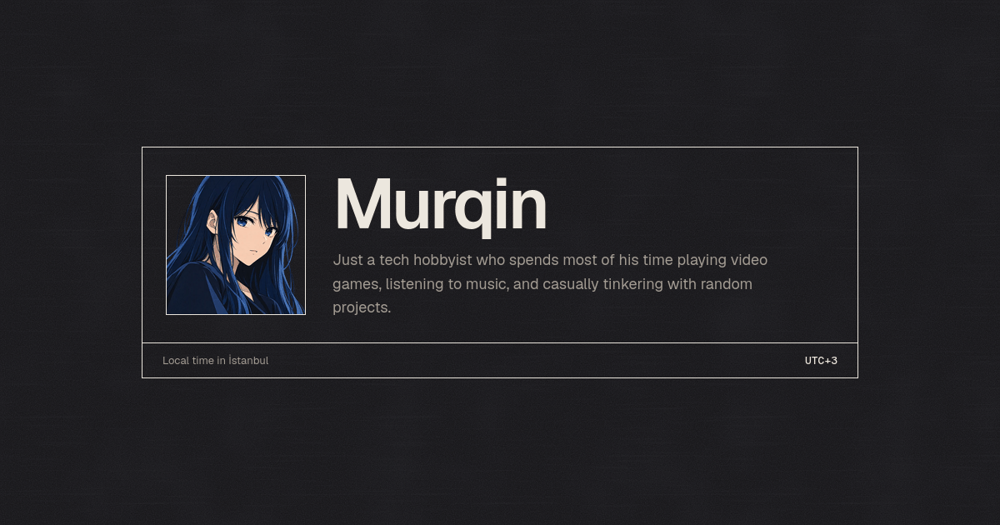

  
   
  <h1>murq.in</h1>
  
Personal bio website styled as a CD booklet printed on paper.

---

### Highlights

- **Pure & Lightweight:** Zero JS frameworks, zero external CDN requests.
- **Paper & ink:** Flat ink on a random paper stock per visit (six dark, six light), with a fibre texture; dark by default, theme choice remembered.
- **One page per screen:** Cover and links each fill the screen with native scroll-snap; a printer's ruler on the right shows where you are.
- **Typography:** 100% self-hosted **Geist Sans** and **Geist Mono** (latin + latin-ext) with preloads.
- **Micro-interactions:**
  - Email copy with inline "Copied" feedback.
  - Keyboard navigation (`1` GitHub, `2` Steam, `3` YouTube, `4` Instagram, `5` Mail).
  - Real-time local time in Istanbul with tabular numerals.
- **Docker-ready:** High-performance `nginx:alpine-slim` setup with Gzip (level 6), immutable asset caching, and security headers.

---

### License & Disclaimer

© 2026 Murqin. All Rights Reserved.

The source code and personal content are All Rights Reserved. Third-party assets, fonts, and trademarks belong to their respective owners. See [LICENSES.md](LICENSES.md) for detailed third-party attributions and licenses.
