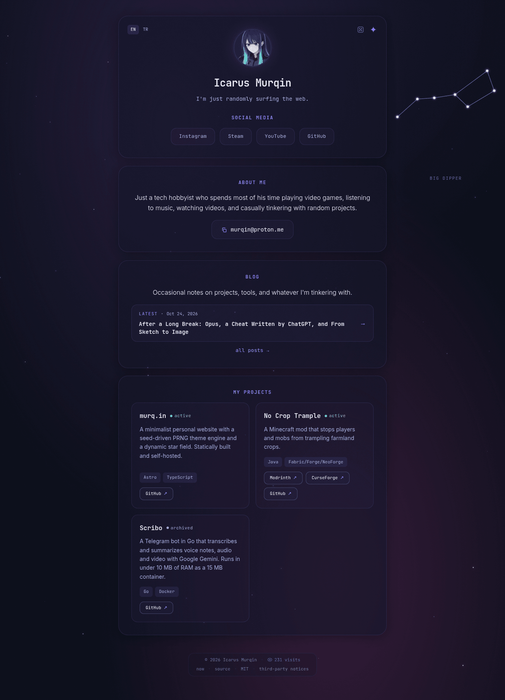

# murq.in

My personal site at [murq.in](https://murq.in). A bit about me, things I'm working
on, and the occasional blog post. In English and Turkish.

The background got a little out of hand. Each visit gets a sky from a random
seed, and you can copy its link to come back to the same one. There's a light
and dark theme, constellations, and a few things to find if you keep pressing
the randomise button.



AI coding agents wrote most of the code. I decide what I want, try it out, and
keep asking for changes. More on that at [/ai](https://murq.in/ai/).

## Running it

It's an Astro site built to static files, with a small Node server for seed
URLs and the visitor counter. The server has no runtime dependencies.

With Node 22.22 or newer:

```sh
npm ci
npm run dev
```

That starts Astro at `http://localhost:4321`. To try seed URLs such as
`/1a2b3c4d5e6f` and the visitor counter, use the Node server:

```sh
npm run build:all
npm run serve
```

It runs at `http://localhost:8080`. `npm test` builds everything and runs the
test suites.

## Changing things

Posts live in `src/content/blog/`. A post needs `title`, `date`, and `summary`
in its frontmatter. Put its Turkish version in `src/content/blog/tr/` with the
same filename. Astro generates the post pages, feeds, sitemap, raw Markdown,
and link previews at build time.

Projects and the `/now`, `/ai`, and `/colophon` pages live in `src/data/`.
UI translations are in `src/lib/i18n.ts`, styles in `src/styles/style.css`,
and the sky and theme code in `src/scripts/`.

## Hosting

I run it on my own server behind Cosmos Cloud and Cloudflare. GitHub Actions
builds the container image and pushes it to GHCR; the server checks for updates
and rolls back if the new container fails its health check.

The Node server reads these environment variables. `npm run serve` sets them
up for local use.

| Variable | Default | Used for |
| --- | --- | --- |
| `PORT` | `8080` | Listen port |
| `SITE_ROOT` | `/srv/site` | Built site directory |
| `DATA_DIR` | `/data` | Visitor count storage (`visitors.json`) |
| `ALLOWED_ORIGINS` | `https://murq.in` | Origins allowed to increment the counter |

The container runs as uid 1000 and needs a writable data volume to keep the
visitor count between restarts. The server refuses to start if it can't write
to that directory or read an existing count.

## Licences

The code is [MIT](./LICENSE). Blog posts are
[CC0](https://creativecommons.org/publicdomain/zero/1.0/).
Fonts, images, and constellation data have separate notices in
[LICENSES.md](./LICENSES.md).
